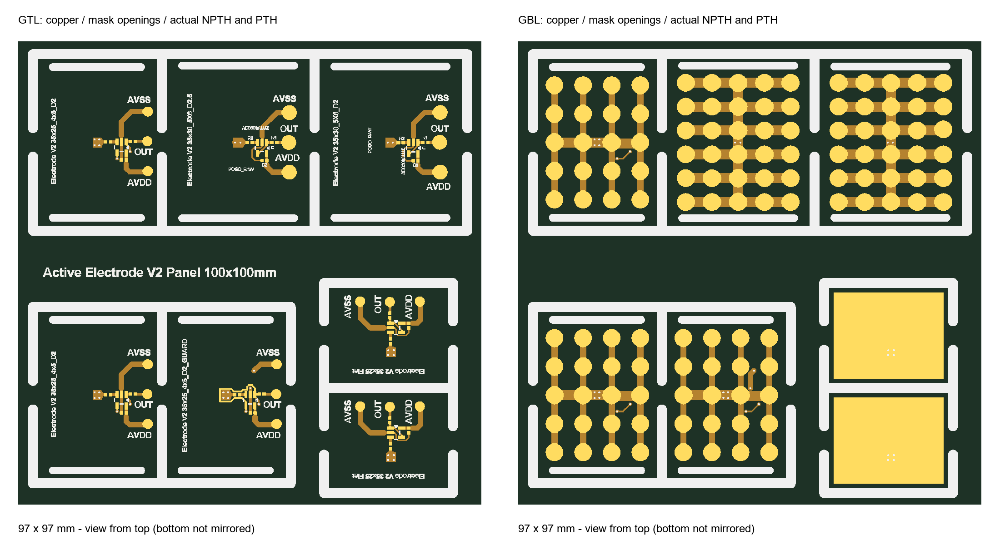

# Active Electrode V2

Các thiết kế điện cực chủ động EEG dùng op-amp **AD8603AUJZ-R2**, gồm điện cực pogo pin, bản driven guard và điện cực phẳng. Thiết kế bằng Altium Designer.

> **Prototype / chưa chốt sản xuất.** Gerber được lưu để quản lý phiên bản, không phải bộ phát hành đã được nhà máy duyệt. Cần sửa các khe solder mask gần guard, xác nhận độ rộng khung panel, chạy lại DRC và kiểm tra CAM trước khi đặt mạch.

## Các phiên bản

| Thư mục | Điện cực (mm) | Pogo pin | Đường kính danh nghĩa | Ghi chú |
|---|---|---|---|---|
| `Electrode_35x25_4x5_D2` | 35 × 25 | 4 × 5 = 20 | 2 mm | Bản cơ sở |
| `Electrode_35x25_4x5_D2_GUARD` | 35 × 25 | 4 × 5 = 20 | 2 mm | Có driven guard |
| `Electrode_35x30_5x6_D2` | 35 × 30 | 5 × 6 = 30 | 2 mm | Mật độ 30 pin |
| `Electrode_35x30_5x6_D2p5` | 35 × 30 | 5 × 6 = 30 | 2,5 mm | So sánh kích thước pin |
| `Electrode_Flat_25x20` | 25 × 20 | Không | — | Mặt dưới là vùng đồng tiếp xúc phẳng |

Kích thước pogo ghi trên là thông số nhận diện phiên bản; phải đối chiếu bản vẽ pin thực tế và kích thước thân hàn trước khi mua/gia công.

## Cấu trúc

- Mỗi thư mục thiết kế có `.PrjPcb`, `.SchDoc`, `.PcbDoc`, `.SchLib`, `.PcbLib` và PDF schematic được lưu cùng dự án.
- `Panel_100x100_Slots.PcbDoc`: panel 7 điện cực, tham chiếu 5 thư mục thiết kế bằng đường dẫn tương đối.
- `manufacturing/export-2026-10-25/`: bản chụp Gerber, file khoan và ZIP của lần xuất ngày 25/10/2026.
- `docs/gerber-review-2026-10-25.md`: kết quả kiểm tra và các điểm cần xử lý.
- `SOURCE_MANIFEST.json`: SHA-256 của các file được sao chép, dùng đối chiếu tính toàn vẹn.

## Mở trong Altium

1. Clone hoặc tải **toàn bộ repository**, giữ nguyên tên và cấu trúc các thư mục.
2. Mở `.PrjPcb` trong thư mục phiên bản muốn sửa.
3. Mở `Panel_100x100_Slots.PcbDoc` ở thư mục gốc để xem panel. Không di chuyển riêng panel sang nơi khác vì embedded boards dùng đường dẫn tương đối.
4. Cập nhật board con trong panel sau khi sửa thiết kế, repour và chạy DRC trước khi xuất lại Gerber/NC Drill.

Snapshot được xuất bằng Altium Designer 26.10.1. Các file nguồn được sao chép nguyên trạng. Một số cấu hình in/xuất cũ trong project có thể còn đường dẫn tuyệt đối của máy thiết kế; cần chọn lại tài liệu và thư mục đầu ra trên máy mới. PDF đi kèm là tài liệu lưu sẵn, không khẳng định đã đồng bộ với mọi chỉnh sửa mới nhất.

## Panel và trạng thái chế tạo

- 7 board con: hai bản 35×25 D2, một bản GUARD, một bản 35×30 D2, một bản 35×30 D2p5 và hai bản Flat.
- **Outline Gerber hiện là 97 × 97 mm**, dù tên file và chữ trên panel còn ghi 100×100 mm.
- File khoan có 32 lỗ PTH Ø0,3 mm, 10 slot NPTH rộng 1,5 mm và 29 slot NPTH rộng 2 mm.
- Kiểm tra hình học bản xuất không thấy đứt/chập giữa các pad/net được đối chiếu. Điều này không thay thế DRC Altium, so sánh netlist schematic hoặc duyệt CAM nhà máy.
- Bản GUARD có khe mask khoảng 0,043–0,071 mm cần chỉnh trước khi chốt sản xuất.
- Khung ngoài chỉ còn khoảng 1,35–2,10 mm, cần gia cố hoặc được nhà sản xuất chấp thuận.
- Chưa xác nhận chất lượng tín hiệu, an toàn điện hay tính tương thích sinh học của vật liệu tiếp xúc.

## An toàn

Chỉ dùng cho phát triển và nghiên cứu, không phải thiết bị y tế được chứng nhận. Kiểm tra bằng bộ mô phỏng tín hiệu trước; không gắn lên người khi đang nối trực tiếp với nguồn điện lưới hoặc USB không được cách ly, đánh giá an toàn phù hợp.

## Quản lý phiên bản

Lịch sử Altium, backup, log và các panel trung gian không được đưa vào repository. Đây là bản sao độc lập để quản lý bằng Git; sửa trong thư mục repository hoặc đồng bộ có kiểm soát từ thư mục Altium gốc trước khi commit tiếp. Không tự động đồng bộ hai thư mục.

Chưa lựa chọn giấy phép phân phối; chưa cấp quyền sử dụng lại bằng một giấy phép nguồn mở.
